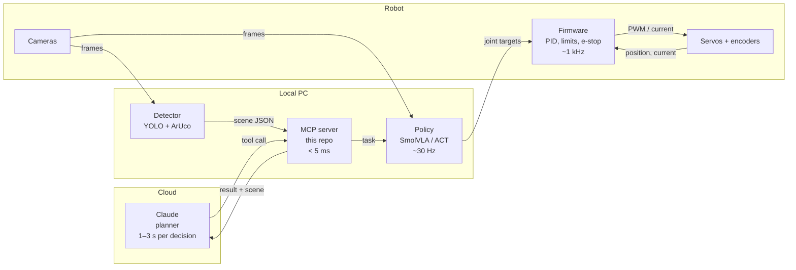
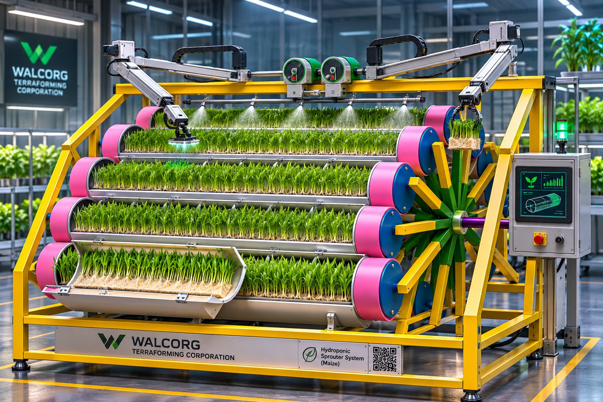
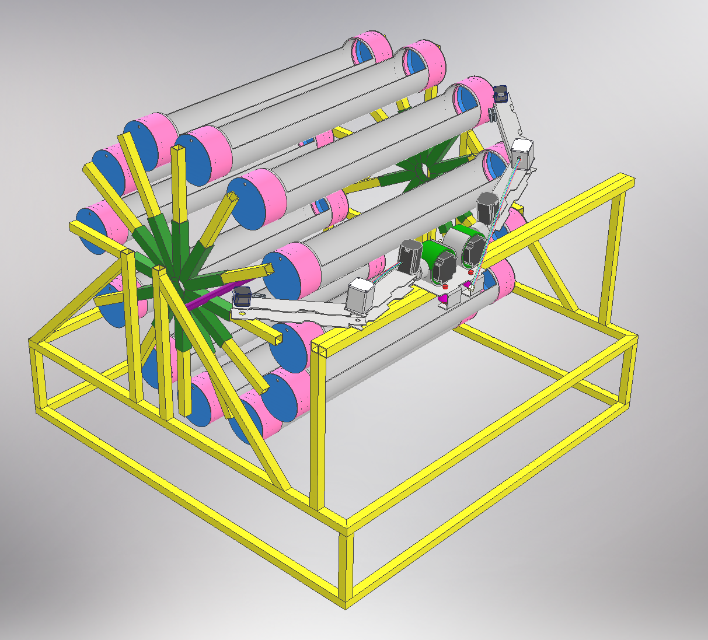
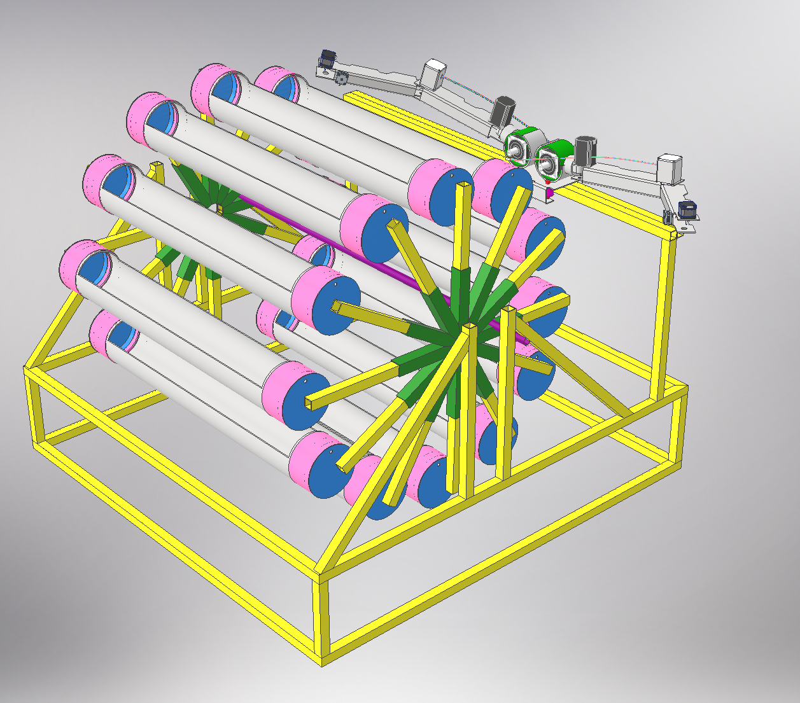
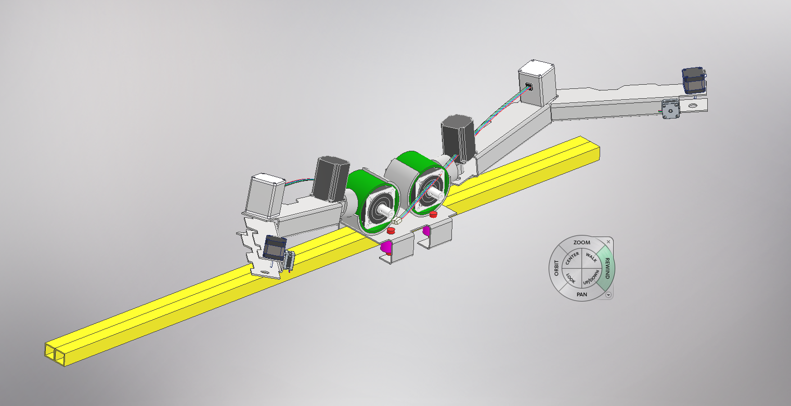
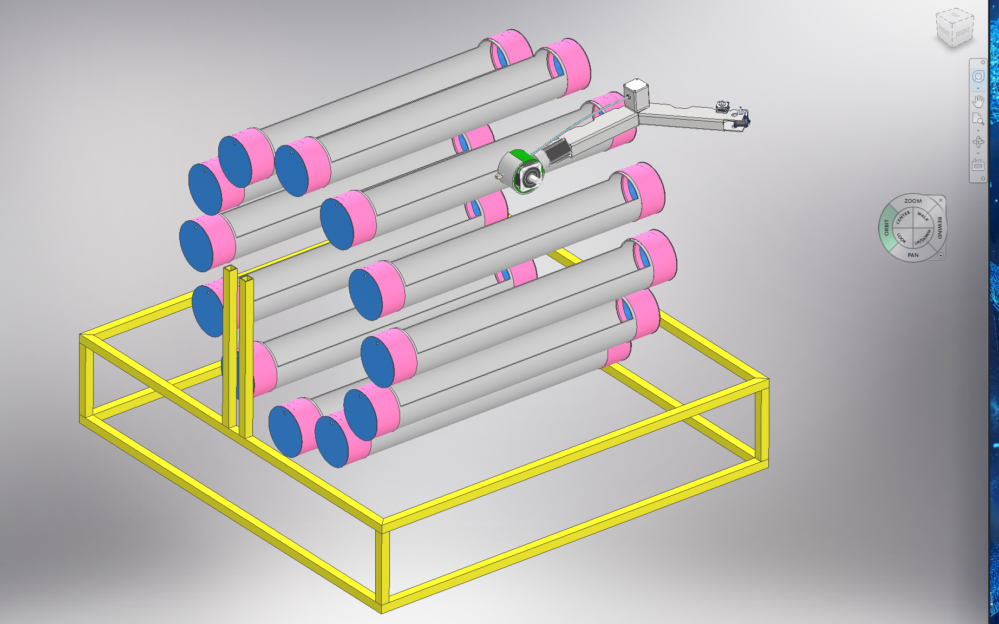
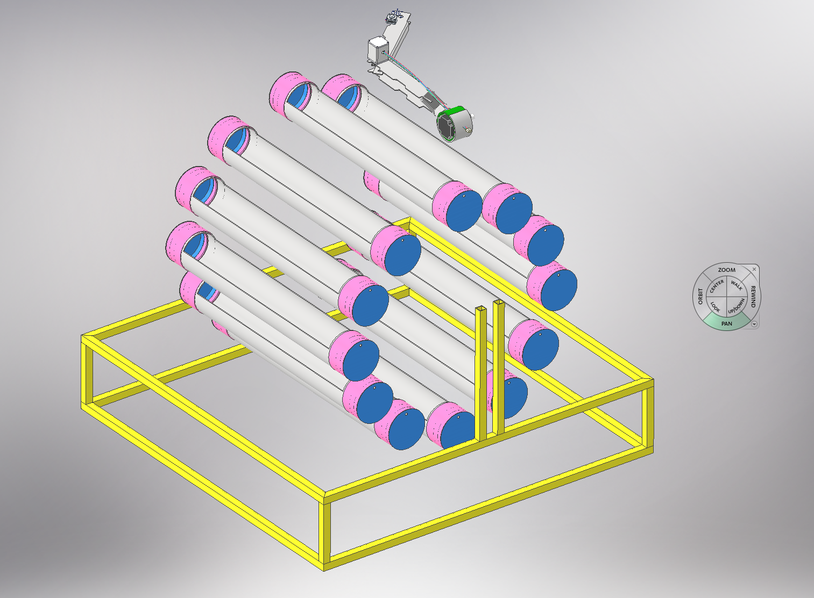
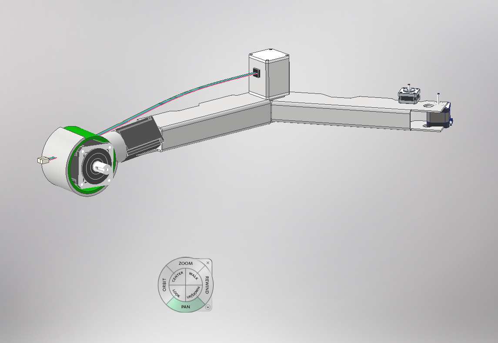
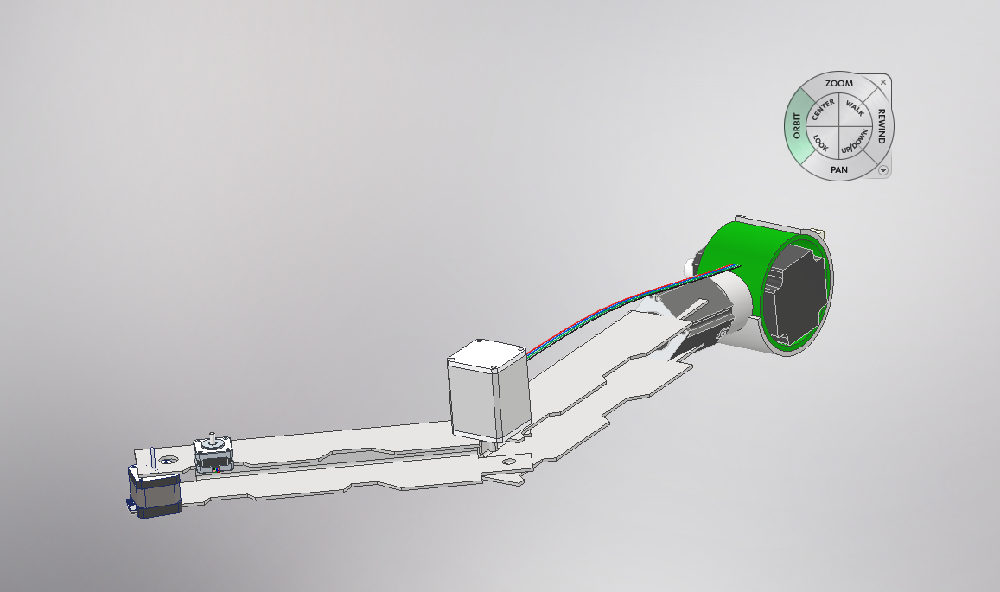

# robotarm-lab

A dual-arm robot with a camera and dexterous hands, planned by Claude through MCP, executed by a
local learned policy (LeRobot) and kept safe by real-time firmware.

Claude decides **what** to do ("move the cup from station 2 to station 3 with the left hand").
A local policy decides **how** to move the fingers, 30 times per second. The firmware closes
the loop on every joint at 1 kHz and owns every safety limit.



## Design principles

1. **Claude is the planner, never the controller.** It sees the scene as JSON (plus an image only
   when needed), calls a small set of tools and reads back a result code. It is never in a
   real-time loop.
2. **Objects live in fixed stations.** Every object the hands handle sits in a numbered station
   with self-centring guides and an ArUco marker. Claude addresses stations, not coordinates.
   This removes most of the uncertainty in manipulation.
3. **Safety lives in firmware and hardware.** Joint limits, current limits, watchdog and the
   e-stop are enforced below every layer that can be wrong, including Claude and the policy.
4. **Same interface from simulation to the real arms.** The MCP layer talks to a `Backend`;
   the simulated backend, the SO-101 test arms and the custom arms all implement it.

## Design

### Concept render



*This image was enhanced with AI (neural rendering) from the CAD concept. It is an
illustration, not the engineering model: details such as the spray bar, control cabinet and
signage are artistic and may differ from the final design.*

### Current CAD model

Created with **Autodesk Inventor**. Dimensions and parts are not final.

**Rotating reel and dual-arm carriage**: twelve cultivation tubes mounted on two 12-spoke hubs
around a central shaft. The reel rotates to bring each tube to the arms. Both arms sit back to
back on one sliding carriage that runs along a rail above the reel.

<table>
  <tr>
    <td></td>
    <td></td>
  </tr>
</table>

**Dual-arm carriage on the rail**:



### Earlier iterations

First 3D sketches, also created with **Autodesk Inventor**.

**Reel-shaped grow rack with the arm**: cultivation tubes arranged as a reel on a steel frame,
with the arm mounted beside it.

<table>
  <tr>
    <td></td>
    <td></td>
  </tr>
</table>

**Arm**: base joint with a large stepper and housing, two links, and smaller steppers at the
elbow and the wrist.

<table>
  <tr>
    <td></td>
    <td></td>
  </tr>
</table>

## Status

| Phase | Goal | State |
|-------|------|-------|
| 0 | Repository, specs, MCP server with simulated backend | ✅ this commit |
| 1 | Validate the pipeline on LeRobot SO-101 arms | planned |
| 2 | Record datasets, train a manipulation policy | planned |
| 3 | Design and build the custom arms and hands (Autodesk Inventor) | planned |
| 4 | Integrate cameras, stations and Claude on the real cell | planned |

Details and exit criteria: [docs/roadmap.md](docs/roadmap.md).

## Try the simulated cell

```bash
git clone https://github.com/walcorg/robotarm-lab
cd robotarm-lab
python -m venv .venv && source .venv/bin/activate
pip install -e ".[dev]"
pytest -q

# Register the MCP server with Claude Code and talk to the simulated cell
claude mcp add robotarm -- robotarm-mcp --backend sim
claude
> Move the cup to the handover station, then pass it to the right hand and put it in outbound.
```

`--grip-fail-rate 0.3` makes the simulator drop grasps so you can see how Claude recovers.

## Repository layout

| Path | Contents |
|------|----------|
| `src/robotarm_lab/` | MCP server, validation controller, backends (`sim` today) |
| `config/workcell.toml` | Stations, hands and reach; initial objects for simulation |
| `docs/` | Architecture, MCP tool spec, scene schema, safety, roadmap |
| `docs/visualization/` | Animated view of one decision travelling from the model to the servos |
| `hardware/` | Inventor sources and exports for arms, hands and workcell |
| `firmware/` | Joint controller firmware (requirements first, code in phase 1–3) |
| `policy/` | LeRobot configs, dataset notes and trained policy cards |

## Documentation

- [Architecture](docs/architecture.md): layers, timing budget, interfaces
- [MCP tools](docs/mcp-tools.md): every tool, its arguments and result codes
- [Scene schema](docs/scene-schema.md): the JSON Claude reads
- [Safety](docs/safety.md): what each layer is allowed to do
- [Roadmap](docs/roadmap.md): phases and exit criteria

## License

- Software (everything outside `hardware/`): [MIT](LICENSE)
- Hardware designs in `hardware/`: [CERN-OHL-W-2.0](LICENSE-HARDWARE)

© 2026 WALCORG
