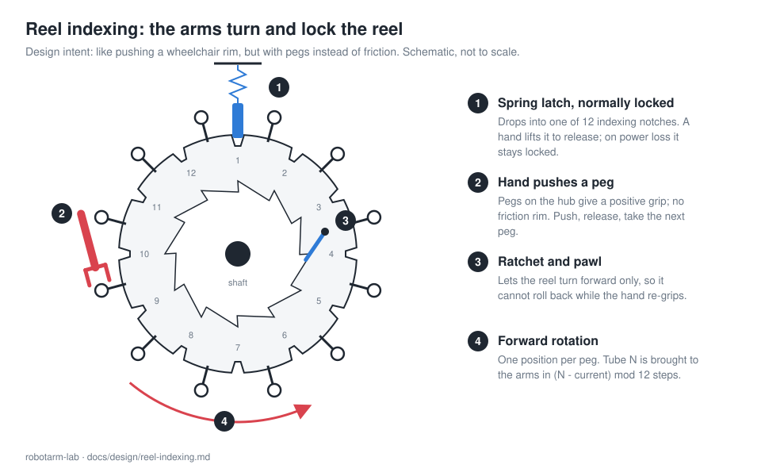

# Design decision: the arms turn and lock the reel

**Status:** accepted (concept) · **Date:** 2026-11-04

## Context

The cultivation reel holds twelve tubes on two 12-spoke hubs around a central shaft. It must
rotate to bring each tube to the arms, and it must be held still while the arms work in a tube.

The first idea was a separate mechanism: a reel motor plus a locking device. That adds a
motor, a transmission, a driver, a brake and their wiring, all to perform an action the arms are
already in position to do.

## Decision

The reel has **no motor**. The arms turn it and the reel locks itself:

1. **Spring latch, normally locked.** An indexing plate on the hub has 12 notches, one per tube.
   A spring-loaded latch drops into a notch at every position. A hand lifts the latch to
   release the reel. With power off, or if an arm fails, the reel stays locked.
2. **Pegs on the hub.** The hand pushes a peg (like a capstan or a ship's wheel) instead of
   gripping a rim by friction. The intent is the same as pushing a wheelchair rim, but a peg
   gives a positive contact that a robotic hand cannot slip off.
3. **Ratchet and pawl.** The reel turns forward only. One hand can push, let go and take the
   next peg without the reel rolling back, so the other hand stays free (or holds the latch).
4. **Position comes from the notch, not from the arm.** Each tube always stops in the same
   place. A latch-seated switch confirms the lock; an ArUco marker or one Hall sensor per
   position tells which tube faces the arms.

## Consequences

**Benefits**
- One fewer motor, driver, brake and cable run.
- Fail-safe by default: the latch is closed unless a hand is actively holding it open.
- Repeatable tube position without an encoder on the reel.

**Costs and risks**
- **Torque.** The arms must overcome friction plus any imbalance between tubes. Example: 2 kg
  more liquid in one tube at 0.40 m from the shaft is about 8 N·m; pushing a peg at 0.50 m
  needs about 16 N of sustained tangential force at the hand, plus friction. That is demanding
  for NEMA 17 elbow and wrist joints. Mitigations: fill opposite tubes equally, use good shaft
  bearings, and measure the real torque on the prototype with a force gauge before committing.
- **Forward only.** Reaching the previous tube takes 11 steps. Accepted for simplicity; a
  disengageable pawl can be added later if needed.
- **Slower** than a motor: every step is lift, push, release, confirm.

## Software

Turning the reel is a skill like `pick` or `place`:

| Tool | Behaviour |
|------|-----------|
| `bring_tube(tube, hand?)` | Computes `(tube - current) mod 12` forward steps and runs them |
| `rotate_reel(hand, steps)` | Runs an exact number of forward steps (1–11) |

Each step: lift latch → push peg → release → confirm the latch seated. The controller rejects
the request unless the operating hand is empty and **both hands are at home**, because the
tubes sweep through the arms' workspace. If the latch does not seat, rotation stops with
`latch_failed` and all station work is blocked (`reel_unlatched`) until another step seats it.

Implemented in `src/robotarm_lab/controller.py` and the simulated backend; tested in
`tests/test_reel.py`. Configuration: `[reel]` in `config/workcell.toml`.

## Hardware requirements added

- Indexing plate with 12 notches and a spring latch reachable by at least one hand
- 12 pegs on the hub, one per position, at a radius both hands can reach from the travel pose
- Ratchet and pawl on the shaft
- Latch-seated switch (wired to the firmware) and a tube-position sensor
